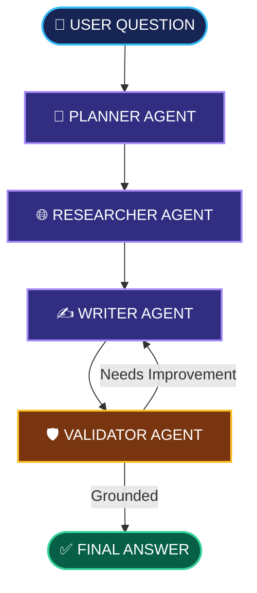

<div align="center">

# 🚀 MULTI-AGENT AI RESEARCH ASSISTANT


### 🤖 INTELLIGENT RESEARCH • 🌐 WEB SEARCH • ✅ FACT VALIDATION


<br/>


</div>

---

# `01` — 🎯 PROJECT OVERVIEW

### Research smarter. Not harder.

The **Multi-Agent AI Research Assistant** is a Python-based AI application that uses multiple specialized agents to research questions, gather web sources, generate answers, and validate whether those answers are supported by available evidence.

Instead of relying on a single agent for every task, the system divides research into specialized steps. Each agent contributes to a shared workflow managed by LangGraph.

### ✨ KEY FEATURES

- 🤖 **Multi-Agent Architecture** — Specialized agents work together.
- 🌐 **Web Research** — Retrieves relevant information using Tavily.
- 🧠 **AI Reasoning** — Uses Groq-powered language models.
- ✍️ **Automated Writing** — Produces structured research answers.
- 🛡️ **Answer Validation** — Checks answers against gathered evidence.
- 🔄 **Self-Correction** — Supports limited revisions when needed.
- ⛓️ **Workflow Control** — Routes tasks between agents and limits revision cycles.

---

# `02` — ⚙️ HOW IT WORKS

<div align="center">

### FROM QUESTION TO VERIFIED ANSWER

</div>



### 🧠 THE FOUR SPECIALIZED AGENTS

<details>
<summary><b>01 — Planner Agent</b></summary>

Analyzes the question and creates focused research queries.

</details>

<details>
<summary><b>02 — Researcher Agent</b></summary>

Searches the web and gathers relevant information and source material.

</details>

<details>
<summary><b>03 — Writer Agent</b></summary>

Transforms the gathered research into a clear, structured answer.

</details>

<details>
<summary><b>04 — Validator Agent</b></summary>

Checks whether the answer is supported by the available research and determines whether it needs improvement.

</details>

### 🔄 REVISION LOOP

When an answer needs improvement, the workflow can send it back to the writer.

The revision limit is **up to two revisions**, helping prevent endless retries.

---

# `03` — 🧰 TECHNOLOGY STACK

| Technology | Role |
|:---|:---|
| 🐍 **Python 3.11** | Core programming language |
| 🦜 **LangGraph** | Agent orchestration and workflow routing |
| ⚡ **Groq** | Language model inference |
| 🌐 **Tavily** | Web search and research |
| 📦 **Pydantic** | Structured data validation |

### 🔗 OFFICIAL RESOURCES

- [Python](https://www.python.org/)
- [LangGraph](https://www.langchain.com/langgraph)
- [Groq Console](https://console.groq.com/)
- [Tavily Dashboard](https://app.tavily.com/)
- [Pydantic Documentation](https://docs.pydantic.dev/)

---

# `04` — 💡 WHY MULTI-AGENT AI?

<div align="center">

| 🧩 SPECIALIZATION | 🌐 RESEARCH | 🛡️ VALIDATION |
|:---:|:---:|:---:|
| Dedicated roles for each task | Information retrieved from the web | Additional grounding checks |

</div>

### WHAT MAKES IT USEFUL?

- **Modular workflow:** Each agent has a defined responsibility.
- **Evidence-based answers:** Retrieved sources provide material for the response.
- **Iterative improvement:** The writer can revise answers when requested by the validator.
- **Controlled execution:** A revision limit helps avoid an endless loop.

> **Core idea:** Plan the research, gather evidence, write the answer, and check its grounding.

---

# `05` — 📊 EVALUATION

The project includes an evaluation script for testing the agent workflow.

Run it from the project root:

```bash
python evals/run_evals.py
```

Depending on the evaluation script, output may include:

- 📚 Sources gathered
- 🔄 Revisions performed
- ✅ Validator grounding results

Results depend on the configured models, available API services, and evaluation cases.

---

# `06` — 🚀 QUICK START

### `STEP 01` — OPEN THE PROJECT

Open the project folder in Visual Studio or a terminal.

### `STEP 02` — CREATE A VIRTUAL ENVIRONMENT

```powershell
python -m venv .venv
.\.venv\Scripts\Activate.ps1
```

### `STEP 03` — INSTALL DEPENDENCIES

```bash
python -m pip install --upgrade pip
pip install -r requirements.txt
```

### `STEP 04` — CONFIGURE API KEYS

Create a `.env` file in the project root:

```dotenv
GROQ_API_KEY=your_groq_api_key
TAVILY_API_KEY=your_tavily_api_key
```

Get your keys from the official dashboards:

- [Get a Groq API key](https://console.groq.com/)
- [Get a Tavily API key](https://app.tavily.com/)

🔐 **Security:** Keep `.env` private. Never publish API keys in your repository.

### `STEP 05` — RUN THE APPLICATION

```bash
python -m src.multi_agent_research_assistant.app
```

When prompted with `Question:`, enter a research question.

**Example:**

```text
What are the latest developments in solid-state batteries?
```

---

# `07` — 📁 PROJECT STRUCTURE

```text
multi-agent-research-assistant/
│
├── src/
│   └── multi_agent_research_assistant/
│       └── app.py
│
├── evals/
│   └── run_evals.py
│
├── .gitignore
├── README.md
├── pyproject.toml
├── requirements.txt
└── uv.lock
```

*Simplified overview; the project may contain additional source modules and configuration files.*

---

<div align="center">

# 🌌 THE FUTURE OF RESEARCH IS COLLABORATIVE


**BUILT WITH PYTHON · LANGGRAPH · GROQ · TAVILY**


*Turning questions into structured, source-grounded research.*

</div>
