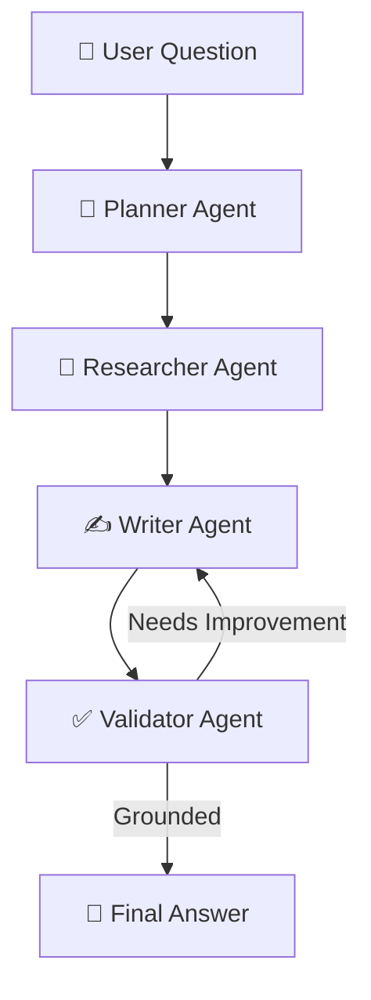

<div align="center">

# 🚀 Multi-Agent-Ai-Research-Assistant

### 🤖 Intelligent Research • 🔎 Web Search • ✅ Fact-Checked Answers

A multi-agent AI research system that searches the web, gathers sources, writes answers, and validates them for accuracy.

<br/>

[](https://www.python.org/)
[](https://www.langchain.com/langgraph)
[](https://console.groq.com/)
[](https://app.tavily.com/)
[](https://docs.pydantic.dev/)

<br/>

[📘 Complete User Guide](docs/User_Guide.pdf)

</div>

---

# 🎬 01 — Project Overview

AI Multi-Agent Research Assistant is a Python-based AI project that researches questions using the web and generates cited, fact-checked answers.

Instead of relying on one AI agent, it uses multiple specialized agents that work together to research, write, and validate the final response.

### ✨ Key Features

- 🤖 Multi-agent AI workflow
- 🌐 Web research with Tavily
- 🧠 AI-powered reasoning with Groq
- ✍️ Automated answer generation
- ✅ Source-grounded answer validation
- 🔄 Automatic revision when an answer needs improvement
- 🛑 Limited revision loop to avoid endless retries

---

# ⚙️ 02 — How It Works



### 🔢 Agent Responsibilities

**1. 🧠 Planner Agent**  
Creates research queries for the question.

**2. 🔎 Researcher Agent**  
Searches the web and collects relevant sources.

**3. ✍️ Writer Agent**  
Uses the gathered information to draft an answer.

**4. ✅ Validator Agent**  
Checks whether the answer is supported by the available sources.

**5. 🔄 Revision Loop**  
If the answer needs improvement, it returns to the writer, with a maximum of two revisions.

---

# 🛠️ 03 — Technology Stack

<div align="center">

| Technology | Purpose |
|:---|:---|
| 🐍 **Python 3.11** | Core programming language |
| 🦜 **LangGraph** | Multi-agent workflow and routing |
| ⚡ **Groq** | AI model inference |
| 🌐 **Tavily** | Web search and research |
| 📦 **Pydantic** | Structured data validation |

</div>

### 🔗 Useful Links

- [Python](https://www.python.org/)
- [LangGraph](https://www.langchain.com/langgraph)
- [Groq Console](https://console.groq.com/)
- [Tavily Dashboard](https://app.tavily.com/)
- [Pydantic Documentation](https://docs.pydantic.dev/)

---

# 📥 04 — Installation

### Requirements

- Python 3.11
- Groq API key
- Tavily API key

### Step 1 — Open the Project

Open the project folder in Visual Studio or your preferred terminal.

### Step 2 — Create a Virtual Environment

```bash
python -m venv .venv
```

Activate it on Windows PowerShell:

```powershell
.\.venv\Scripts\Activate.ps1
```

If script execution is blocked, run:

```powershell
Set-ExecutionPolicy -Scope Process Bypass
```

Then activate the environment again.

### Step 3 — Install Dependencies

```bash
python -m pip install --upgrade pip
pip install -r requirements.txt
```

---

# 🔐 05 — API Configuration

Create a `.env` file in the project root directory.

Add your own API keys:

```dotenv
GROQ_API_KEY=your_groq_api_key
TAVILY_API_KEY=your_tavily_api_key
```

### 🔑 Get Your API Keys

- ⚡ [Get a Groq API Key](https://console.groq.com/)
- 🔎 [Get a Tavily API Key](https://app.tavily.com/)

> 🔒 **Security:** Never upload your `.env` file or expose API keys in screenshots, public repositories, or messages. Keep `.env` in `.gitignore`.

---

# ▶️ 06 — Run the Assistant

Start the application from the project root:

```bash
python -m src.multi_agent_research_assistant.app
```

When the application displays `Question:`, enter a research question in English.

### 💡 Example Question

```text
What are the latest developments in solid-state batteries?
```

The assistant researches the topic, gathers sources, generates an answer, and validates the result.

---

# 📊 07 — Results and Evaluation

The project includes an evaluation script for testing the agent workflow.

Run it with:

```bash
python evals/run_evals.py
```

Each research run reports information such as:

- 📚 Number of sources gathered
- 🔄 Number of revisions
- ✅ Whether the validator marked the answer as grounded

---

# 🧩 08 — Design Notes

- **LangGraph:** Manages the workflow and conditional transitions between agents.
- **Pydantic:** Helps validate structured outputs from the planner and validator.
- **Groq JSON mode:** Used for structured model responses.
- **Revision limit:** Caps self-correction at two revisions to avoid an endless loop.

---

# 📘 09 — Complete User Guide

Need help installing or running the project?

<div align="center">

### 📖 Step-by-step User Guide

Installation • API Setup • Running the Project • Troubleshooting

[](docs/User_Guide.pdf)

</div>

**To connect your guide:** Save your PDF as `User_Guide.pdf` inside a folder named `docs` in your project.

Your folder structure should look like this:

```text
multi-agent-research-assistant/
├── docs/
│   └── User_Guide.pdf
├── evals/
├── src/
├── .gitignore
├── README.md
├── pyproject.toml
└── requirements.txt
```

If you store the guide somewhere else, update the button link accordingly.

---

# 🌟 10 — Project Goal

The goal of this project is to demonstrate how multiple AI agents can collaborate to perform web research, generate useful answers, and verify their grounding in gathered sources.

<div align="center">

### 🚀 Built with Python, LangGraph, Groq & Tavily

**AI-Powered Research • Multi-Agent Collaboration • Source-Grounded Answers**

</div>
