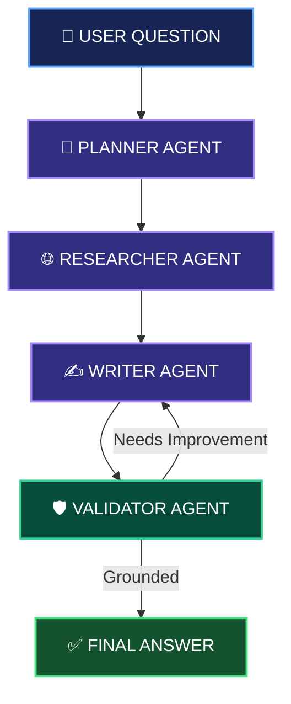

<div align="center">

# MULTI-AGENT AI RESEARCH ASSISTANT

### 🤖 RESEARCH SMARTER. THINK DEEPER. VERIFY BETTER.

**An AI-powered research system built with multiple specialized agents.**

Search the web • Gather evidence • Generate answers • Validate sources

<br/>


<br/>

**⚡ INTELLIGENT RESEARCH | 🌐 LIVE WEB SEARCH | ✅ SOURCE VALIDATION**

</div>

---

# `01` — 🎯 THE PROJECT

## **Research powered by collaboration, not a single agent.**

The **Multi-Agent AI Research Assistant** is a Python-based application that uses multiple AI agents to research questions, collect web sources, write answers, and validate whether the results are supported by the gathered evidence.

Instead of depending on one agent for everything, the system divides the research process into specialized tasks.

### ✨ CORE FEATURES

- 🤖 **Multi-Agent Architecture** — Specialized agents collaborate on one task.
- 🌐 **Web Research** — Retrieves relevant information through Tavily.
- 🧠 **AI Reasoning** — Uses Groq-powered language models.
- ✍️ **Automated Writing** — Generates structured research answers.
- 🛡️ **Source Validation** — Checks whether answers are grounded in collected evidence.
- 🔄 **Self-Correction** — Allows limited revisions when an answer needs improvement.

---

# `02` — ⚙️ HOW THE SYSTEM WORKS



### 🔢 THE FOUR SPECIALIZED AGENTS

**01 — 🧠 PLANNER**

Breaks the user's question into focused research queries.

**02 — 🌐 RESEARCHER**

Searches the web and collects relevant information and sources.

**03 — ✍️ WRITER**

Uses the collected research to prepare a clear answer.

**04 — 🛡️ VALIDATOR**

Checks whether the answer is supported by the available evidence and sends it back for improvement when necessary.

**↻ REVISION LOOP:** The workflow allows up to two revisions to improve an answer without creating an endless loop.

---

# `03` — 🧰 TECHNOLOGY STACK

| TECHNOLOGY | ROLE IN THE PROJECT |
|:---|:---|
| 🐍 **Python 3.11** | Core application |
| 🦜 **LangGraph** | Agent workflow and routing |
| ⚡ **Groq** | Language model inference |
| 🌐 **Tavily** | Web search and research |
| 📦 **Pydantic** | Structured data validation |

---

# `04` — 💡 WHY THIS PROJECT?

### **MODULAR**
Each agent has a specific responsibility, making the workflow easier to understand and maintain.

### **EVIDENCE-BASED**
The assistant uses retrieved sources to support its research answers.

### **SELF-CORRECTING**
The validator can request revisions when the generated response needs improvement.

### **CONTROLLED**
A revision limit helps prevent endless writer-validator cycles.

---

# `05` — 📊 RESEARCH & EVALUATION

The project includes an evaluation script to test the research workflow.

Evaluation can report:

- 📚 Sources collected
- 🔄 Revisions performed
- ✅ Validator grounding results

Run the evaluation script from the project root:

```bash
python evals/run_evals.py
```

---

# `06` — 🚀 QUICK START

### **STEP 01 — OPEN THE PROJECT**

Open the project folder in Visual Studio or a terminal.

### **STEP 02 — CREATE & ACTIVATE ENVIRONMENT**

```powershell
python -m venv .venv
.\.venv\Scripts\Activate.ps1
```

### **STEP 03 — INSTALL DEPENDENCIES**

```bash
python -m pip install --upgrade pip
pip install -r requirements.txt
```

### **STEP 04 — CONFIGURE API KEYS**

Create a `.env` file in the project root:

```dotenv
GROQ_API_KEY=your_groq_api_key
TAVILY_API_KEY=your_tavily_api_key
```

Get your keys from:

- [Groq Console](https://console.groq.com/)
- [Tavily Dashboard](https://app.tavily.com/)

**Security:** Keep `.env` private and never publish your API keys.

### **STEP 05 — RUN THE ASSISTANT**

```bash
python -m src.multi_agent_research_assistant.app
```

Enter your research question when prompted.

**Example:**

```text
What are the latest developments in solid-state batteries?
```

---

<div align="center">

# 🌟 BUILT FOR INTELLIGENT RESEARCH

**MULTI-AGENT AI • WEB INTELLIGENCE • SOURCE-GROUNDED ANSWERS**

<br/>

*Powered by Python, LangGraph, Groq and Tavily.*

</div>
